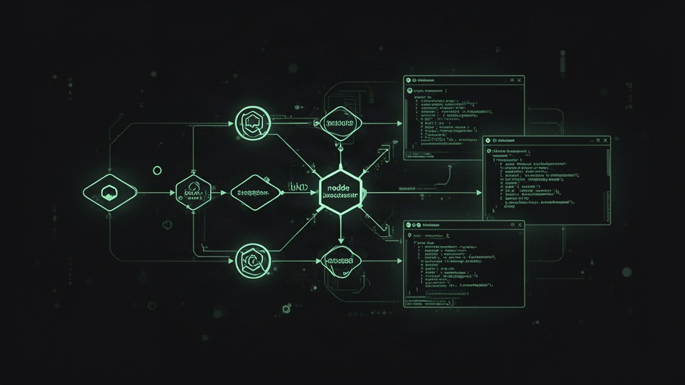
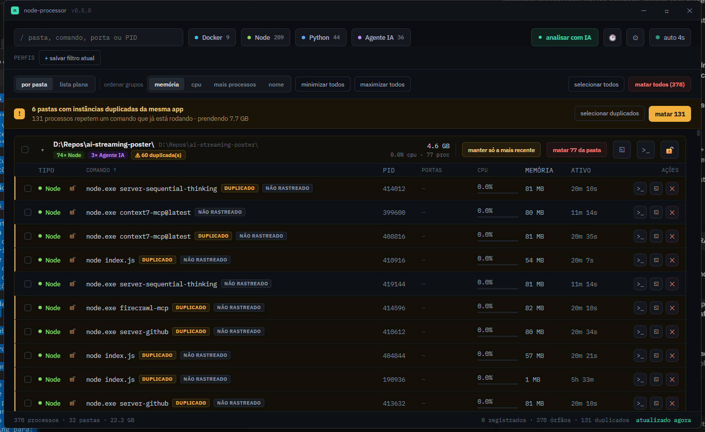

<div align="center">



# node-processor

**Tudo que está rodando na sua máquina, em uma tabela.**

Node, Python, Docker e agentes de IA espalhados por dezenas de pastas de projeto.
O node-processor acha todos — registrados ou não — mostra porta, CPU e memória,
e mata o que você quiser com um clique.

[](https://tauri.app)
[](https://www.rust-lang.org)
[](https://react.dev)
[](LICENSE)

</div>

---

## O problema

- **"Já tem algo nessa porta"** — um `npm run dev` de três dias atrás, numa pasta que você esqueceu.
- **RAM que ninguém pediu** — watchers, containers, agentes de IA em loop, e o Gerenciador de Tarefas só mostra dezenas de `node.exe` idênticos.
- **Matar sem saber o que morre** — sem pasta, sem comando original, sem log. Você chuta o PID e descobre depois qual projeto quebrou.

## O que o node-processor faz

- **Descoberta híbrida**: lê o `dev-registry.json` que você já mantém (pasta, comando, log) **e** varre o sistema inteiro via `sysinfo` — processos não registrados aparecem marcados como `não rastreado`, nunca escondidos.
- **Portas em escuta**: cruza cada PID com `netstat -ano`; clique numa porta e o navegador abre nela.
- **Containers Docker**: `docker ps` cruzado por nome/pasta, aparecendo junto do resto do projeto.
- **Agrupar por pasta ou lista plana**, com árvore de processos pai/filho, ordenação por qualquer coluna, colunas redimensionáveis.
- **Detecção de duplicados**: instâncias redundantes do mesmo comando na mesma pasta, com "manter só a mais recente".
- **Consultor de limpeza por IA**: roda uma heurística local (sem chave) ou consulta OpenRouter/OpenAI (chave fica só no backend Rust, nunca no navegador) e classifica cada processo como seguro/cuidado/manter.
- **Whitelist de proteção**: marque processos ou pastas inteiras como "nunca matar".
- **Perfis de limpeza salvos** e **histórico de kills** (o que morreu, quando, quanta memória liberou).
- **Atalhos de teclado**: `/` busca, `Ctrl+A` seleciona tudo, `Delete` mata a seleção, `Esc` fecha painéis.
- **Log ao vivo**: tail do `.dev-registry.log` do processo, direto no app.

## Screenshot

<div align="center">

</div>

---

## Rodando localmente

### Pré-requisitos

| Ferramenta | Versão mínima | Instalação |
|---|---|---|
| [Rust](https://www.rust-lang.org/tools/install) | 1.77+ | `rustup` |
| [Node.js](https://nodejs.org) | 18+ | qualquer gerenciador (nvm, volta, etc.) |
| [Tauri CLI](https://tauri.app) | 2.x | `npm install -g @tauri-apps/cli` (opcional — já vem como devDependency) |

Dependências nativas por sistema operacional (exigidas pelo Tauri para compilar o webview):

<details>
<summary><strong>Windows</strong></summary>

- [Microsoft Visual Studio C++ Build Tools](https://visualstudio.microsoft.com/visual-cpp-build-tools/) (workload "Desktop development with C++")
- [WebView2](https://developer.microsoft.com/microsoft-edge/webview2/) — já vem instalado no Windows 10/11 atualizados

</details>

<details>
<summary><strong>macOS</strong></summary>

```bash
xcode-select --install
```

</details>

<details>
<summary><strong>Linux</strong></summary>

```bash
# Debian/Ubuntu
sudo apt update
sudo apt install libwebkit2gtk-4.1-dev build-essential curl wget file \
  libxdo-dev libssl-dev libayatana-appindicator3-dev librsvg2-dev

# Fedora
sudo dnf install webkit2gtk4.1-devel openssl-devel curl wget file \
  libappindicator-gtk3-devel librsvg2-devel

# Arch
sudo pacman -S webkit2gtk-4.1 base-devel curl wget file openssl \
  appmenu-gtk-module libappindicator-gtk3 librsvg
```

</details>

### Clonar e instalar

```bash
git clone https://github.com/felvieira/node-processor.git
cd node-processor
npm install
```

### Rodar em modo dev (hot-reload)

```bash
npm run tauri dev
```

Isso sobe o Vite (frontend) e compila/roda o binário Rust automaticamente,
recarregando a cada mudança em `src/` (frontend) ou recompilando em `src-tauri/`
(backend).

### Verificar antes de commitar

```bash
npx tsc --noEmit                          # type-check do frontend
cd src-tauri && cargo check && cd ..       # type-check do backend
```

---

## Gerando o instalador (build de produção)

O comando `tauri build` compila em modo release e empacota automaticamente
no formato nativo de cada sistema operacional — **rode em cada SO onde
quiser gerar o instalador correspondente** (o Tauri não faz cross-compile
de bundle nativo out-of-the-box):

```bash
npm run tauri build
```

| SO | Saída | Local |
|---|---|---|
| Windows | `.msi` e `.exe` (NSIS) | `src-tauri/target/release/bundle/{msi,nsis}/` |
| macOS | `.dmg` e `.app` | `src-tauri/target/release/bundle/{dmg,macos}/` |
| Linux | `.deb`, `.rpm` e `.AppImage` | `src-tauri/target/release/bundle/{deb,rpm,appimage}/` |

O ícone e os metadados do instalador (nome, descrição, categoria, publisher)
já estão configurados em [`src-tauri/tauri.conf.json`](src-tauri/tauri.conf.json).
Para trocar o ícone, substitua `src-tauri/icons/source-icon.png` (1024×1024)
e rode:

```bash
npx tauri icon src-tauri/icons/source-icon.png
```

---

## Estrutura do projeto

```
node-processor/
├── src/                     # frontend React + TypeScript
│   ├── components/          # componentes de UI
│   └── lib/                 # tipos, API wrappers, lógica pura
├── src-tauri/               # backend Rust
│   └── src/
│       ├── processes.rs     # descoberta/merge de processos (sysinfo + registry)
│       ├── actions.rs       # matar processo, abrir pasta/terminal
│       ├── docker.rs        # integração docker ps/stop
│       ├── ports.rs         # netstat -ano
│       ├── ai.rs            # consultor de limpeza (OpenRouter/OpenAI)
│       ├── protected.rs     # whitelist de processos/pastas
│       └── history.rs       # histórico de kills
├── landing/                 # landing page estática (deploy via Coolify)
└── .github/                 # assets do README
```

## Como funciona a descoberta híbrida

1. Lê `dev-registry.json` (metadata rica: pasta, comando original, log).
2. Varre todo processo Node/Python/Docker/agente de IA vivo na máquina via `sysinfo`.
3. Casa cada processo com uma entrada do registry por PID (se ainda válido —
   PIDs são reciclados pelo Windows) ou por prefixo de pasta/linha de comando.
4. O que não bate aparece marcado como **não rastreado**, nunca escondido.

## Licença

MIT
